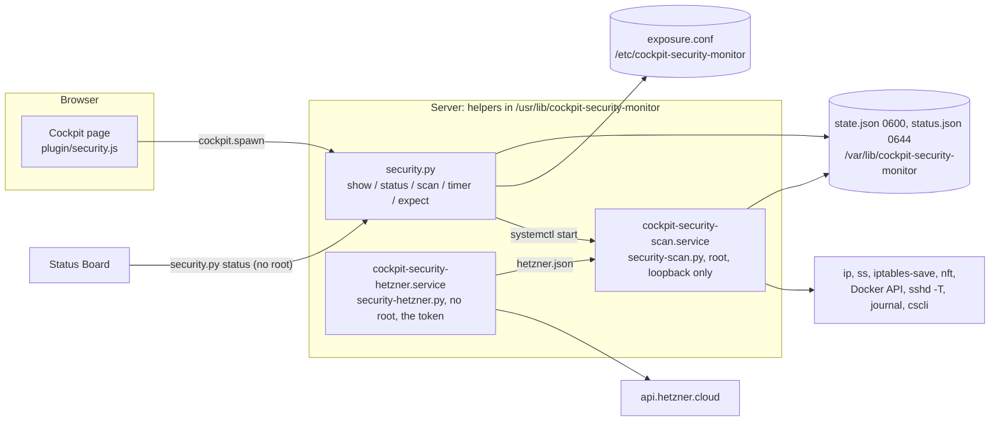

# Security Monitor

A [Cockpit](https://cockpit-project.org/) add-on that answers three questions per server: what is
reachable from where, who logs in, and what is blocked. For every port it says whether a new
connection gets in from the internet, the VPN, the private network or only the server itself, for
IPv4 and IPv6, and which rule decides. It sees what Cockpit's own firewall page does not: UFW, and
the ports Docker forwards past it.

The add-on only reads. A local service checks the server and writes the state; the page shows it.
It changes no firewall rule. The only things the page can change are the add-on's own regular
check and the add-on's own list of findings marked as expected.

A finding of "OK" means: in what this page checks, nothing was found. It never means "safe". What
the page does not understand is "Not assessable", never "OK", and every tab says what it does not
check.

**Contents**

- [What it checks](#what-it-checks)
- [What it does not check](#what-it-does-not-check)
- [Reading the page](#reading-the-page)
- [Architecture](#architecture)
- [Security model](#security-model)
- [Requirements](#requirements)
- [Install](#install)
- [The Hetzner Cloud Firewall](#the-hetzner-cloud-firewall)
- [Marking a finding as expected](#marking-a-finding-as-expected)
- [Operation and troubleshooting](#operation-and-troubleshooting)
- [Development](#development)
- [Known limits](#known-limits)
- [License](#license)

---

## What it checks

| Area | Source on the server | What the page says |
|---|---|---|
| **Exposure** of every listening socket and every port Docker publishes | `ip -j addr`, `ss -tulpn`, Docker's API (GET only), `iptables-save`, `ip6tables-save`, `nft -j list ruleset`, UFW's files | reachable from the internet, the VPN, the private network, this host; per IPv4 and IPv6; the rule or policy that decides; Docker's DNAT to the container and that UFW does not apply to it |
| **Assessment** of each port | the above | databases, Docker's API, Cockpit and SSH open to the internet: danger; web (80, 443), WireGuard and the DHCP client: a note; everything else: a warning until you mark it as expected; reachable only from some addresses: a note |
| **Hetzner Cloud Firewall** (optional) | Hetzner's API with a read-only token | a port it blocks is OK, "protected by the Hetzner Cloud Firewall" |
| **SSH configuration** | `sshd -T`, Match blocks in `sshd_config` | passwords, keyboard-interactive with PAM, root login, keys, attempts, allow lists, X11 and agent forwarding |
| **Authorized keys** of every account with a login shell | the authorized_keys files | type, size, fingerprint, comment, options (`from=`, `restrict`, `command=`); DSA and RSA under 3072 bits; files others can change |
| **Logins** of the last 14 days | the journal of `sshd`, `sshd-session`, `sudo`, `cockpit-session` | successful logins with source, account and method; failed attempts per source; a login from outside VPN and private networks is a warning |
| **Container hardening** | Docker's API | the Docker socket mounted (danger, also read-only), privileged, host PIDs, extra capabilities, writable host folders (warnings), the host network, root, no-new-privileges, AppArmor (notes) |
| **CrowdSec**, when installed | `cscli` (JSON), the firewall bouncer's configuration | the service, version, bouncers, active decisions, alerts of 14 days, whether signals are shared; Ubuntu's outdated package and a bouncer that does not protect container ports are warnings |

How the packet filter is followed: [docs/INTERNALS.md](docs/INTERNALS.md#the-evaluator-secfwpy).
In short: every base chain of the hooks a new connection passes, in order; addresses, ports,
protocols, interfaces, connection state, the original destination after Docker's DNAT, address
types, sets, verdict maps; sources symbolic (all of the internet, the VPN network), so a rule for
one office network makes the port "reachable only from" that network. A rule it cannot read is
followed both ways; if they end differently, the port is "Not assessable" with that rule.

## What it does not check

Always listed on the page, under "Not checked":

- rules it cannot read (marks, `xt` expressions of other tools, an ipset other than as the source): a
  port they decide is "Not assessable",
- who is in an ipset: a port an ipset of sources limits is "reachable only from" that set,
- firewalls and port forwarding outside the server (routers, cloud firewalls other than Hetzner's),
- outgoing connections, ICMP, and what a service does once it is reached (its passwords, its own
  access rules),
- packets addressed to one interface that arrive on another (Linux accepts them; from outside they
  rarely reach a server),
- keys from `AuthorizedKeysCommand`, certificates, and what Match blocks change for some users,
- logins older than 14 days, logins to web applications, the source address of Cockpit sessions,
- vulnerabilities in images (the add-on
  [Image Update Monitor](https://github.com/Azentrius/cockpit-image-update-monitor) shows their
  versions), seccomp, user namespaces, rootless Docker, Podman, compose files,
- whether CrowdSec's scenarios fit the services.

Not part of this add-on: missing updates and restarts
([Update Gaps](https://github.com/Azentrius/cockpit-update-gaps)), cron jobs and timers
([Cron Jobs](https://github.com/Azentrius/cockpit-cronjobs)), backups, setting up CrowdSec, and
changing firewall rules (the page says which rule is missing; you set it by hand). fail2ban follows
in a later version.

## Reading the page

- **Header:** when the server was checked; "Refresh" checks again (with administrative access) or
  reads the summary again (without).
- **Exposure:** an overview (how many ports the internet reaches, the packet filter per family, UFW,
  Docker and DOCKER-USER, the Hetzner Cloud Firewall, the regular check), then every port with its
  service and the four classes. "Details" under the assessment names the binding, Docker's DNAT,
  and the rule or policy that decided per class.
- **SSH, Logins, Containers, CrowdSec:** one tab each. Links like `#/ssh` open a tab, as the
  Status Board does.
- **Without administrative access** the page shows only the summary the Status Board sees.
- **In Cockpit's menu:** the entry "Security Monitor" shows the same state with Cockpit's own icon
  (blue: something to know, yellow: something to look at or a state older than an hour, red: a
  danger, such as a database port open to the internet or the Docker socket in a container) and the
  summary as its tooltip; nothing found, no icon. For this Cockpit loads the page hidden after the
  login; until you open it, it only reads `/var/lib/cockpit-security-monitor/status.json` and
  checks nothing.

## Architecture



| Part | Installed to | Job |
|---|---|---|
| `plugin/` | `/usr/share/cockpit/security/` | the page (plain JavaScript, no build step), English and German |
| `lib/security-scan.py`, `seccheck.py`, `secfw.py`, `seclib.py`, `secproc.py` | `/usr/lib/cockpit-security-monitor/` | every check, the packet filter model, the parsers, commands with time limits |
| `lib/security.py`, `secstatus.py` | `/usr/lib/cockpit-security-monitor/` | the fixed verbs of the page and of the Status Board |
| `lib/security-hetzner.py` | `/usr/lib/cockpit-security-monitor/` | the read-only request to Hetzner's API |
| `systemd/` | `/usr/lib/systemd/system/` | the scan and its timer (every 15 minutes, off until set up), the Hetzner request |

The Status Board finds the status verb in the page's `manifest.json` (`azentrius.status`) and runs
`security.py status --lang en|de`, which needs no administrative access. Interfaces, formats and exit
codes: [docs/INTERNALS.md](docs/INTERNALS.md).

## Security model

- **Read only.** The scan lists; it never changes a firewall rule, never restarts anything. Docker
  is asked with GET only, on a fixed list of paths.
- **Root without the network.** The scan runs in the host's network namespace (it lists it) with
  `IPAddressDeny=any` except the loopback, a cut-down capability set and `ProtectSystem=strict`
  (`tools/check-units.sh` checks the exposure). It writes only its own folder.
- **The token never reaches root code or the browser.** The Hetzner request runs as a user of its
  own (`DynamicUser`) that gets the token as a systemd credential (`LoadCredential=`); the page only
  sees whether a token is set up.
- **Fixed verbs.** The page calls `security.py` with fixed verbs; every argument is checked there.
- **Text, never markup.** Rule texts, container and process names, key comments reach the page as
  text only.
- **Private data stays private.** `state.json` (addresses, user names, key comments) is root's
  (0600); `status.json` for the Status Board holds numbers, states, ports and names of services and
  containers only. Logins are read for 14 days, as long as the journal keeps them on our hosts.
- **The marks file** counts only when root owns it and nobody else can write it.
- **No network from the browser.** No CDNs or external fonts (the fonts ship with the add-on);
  Cockpit's strict CSP stays unchanged.

## Requirements

- Debian 12 or newer, or Ubuntu 22.04 or newer, with systemd and **Cockpit 264** or newer
- **Python 3.8** or newer (standard library only), `iproute2`
- Read when present (the page says what is missing): iptables (nft or legacy), nftables, UFW,
  Docker, OpenSSH, CrowdSec

Fedora, RHEL and openSUSE are not tested yet; firewalld's tables are followed like any other nft
table, but not explained on their own.

## Install

No release yet. To try a build, make the package and install it:

```bash
make packages                                      # needs dpkg-deb and rpmbuild
sudo apt install ./dist/cockpit-security-monitor_0.1.0-1_all.deb
```

The package must be installed on each server you look at in Cockpit, also behind a Cockpit
bastion. Open the page with administrative access: it checks the server once by itself. Set up the
regular check there to keep the state, and the Status Board, current.

Uninstall: `sudo apt remove cockpit-security-monitor`. It stops the timer and removes the state;
`/etc/cockpit-security-monitor` (the marks, the token) stays.

## The Hetzner Cloud Firewall

Optional. Create a token with **Read** permission in the Hetzner Cloud Console (project › Security
› API tokens), then on the server:

```bash
sudo install -m 600 -o root -g root /dev/null /etc/cockpit-security-monitor/hetzner.token
sudo sh -c 'cat > /etc/cockpit-security-monitor/hetzner.token'   # paste the token, then Ctrl-D
sudo systemctl start cockpit-security-scan.service
```

The scan's Hetzner part (`cockpit-security-hetzner.service`) then asks the API for the servers and
firewalls of the project, finds this server by its public address and keeps the incoming rules of
its firewalls. Without a token a server without a filter of its own is "only protected by rules
outside the host, not checkable". A failing API keeps the last good answer; the page says how old
it is. To remove it, delete the file.

## Marking a finding as expected

A port reachable from the internet that is meant to be (a relay, a game server) can be marked as
expected with a note, from the page; so can a container finding (a CI runner that needs the Docker
socket). The finding stays visible as "Marked as expected" and no longer raises the state. The mark
is a line in `/etc/cockpit-security-monitor/exposure.conf`, which you may also edit by hand:

```
port 8080/tcp Rustdesk relay, reachable on purpose
container forgejo-runner docker-socket The CI runner needs the socket
```

## Operation and troubleshooting

```bash
sudo systemctl start cockpit-security-scan.service              # check now (what "Refresh" does)
journalctl -u cockpit-security-scan.service -n 20               # how the last check went
journalctl -u cockpit-security-hetzner.service -n 5             # the last Hetzner request
sudo /usr/lib/cockpit-security-monitor/security-scan.py | less  # the same checks, on stdout
/usr/lib/cockpit-security-monitor/security.py status --lang de  # what the Status Board shows
systemctl list-timers cockpit-security-scan.timer               # the regular check
```

`sshd -T` fails when sshd is socket-activated and `/run/sshd` is missing; the SSH tab shows the one
line for `tmpfiles.d` that fixes it.

## Development

```bash
(cd test && npm ci)                    # jsdom for the page tests
pip install -r test/requirements.txt   # shellcheck, ruff, playwright
make check                             # every offline test
make lint                              # shellcheck, ruff, systemd units and their hardening
python3 tools/preview/build.py         # the page with the scenarios' data:
                                       # tools/preview/out/security/index.html?scenario=ufw-docker&lang=de
```

The helper tests run against three scenarios in `test/fixtures/` (UFW with Docker past it; UFW off
behind a Hetzner Cloud Firewall with CrowdSec; nftables with a verdict map and a failing `sshd -T`)
and their variants. The CI job `e2e` runs spec 4.7 on a throw-away runner: UFW on, Docker publishing
a port, the page in a real Cockpit reporting it as reachable from the internet past UFW, and as VPN
only with a DOCKER-USER rule. More in [CONTRIBUTING.md](CONTRIBUTING.md).

## Known limits

- The packet filter is followed for new TCP and UDP connections; marks, other tools' `xt` matches
  and ipsets other than as the source are not read (the port is then "Not assessable" if they
  decide). An ipset of sources limits a port to "ipset NAME" without knowing its members; a source
  port counts as the sender's choice.
- A socket bound to a VPN or private address counts as reachable only from that class (packets for
  it from elsewhere would need a route through this server).
- Docker's nftables mode (Docker 29, experimental) is followed through its DNAT and forward chains,
  but has not been seen on a host yet.
- Logins come from the journal: a host keeping it shorter shows fewer days.

## License

Apache-2.0, see [LICENSE](LICENSE). Third-party material (fonts, icons) is listed in
[NOTICE](NOTICE).
