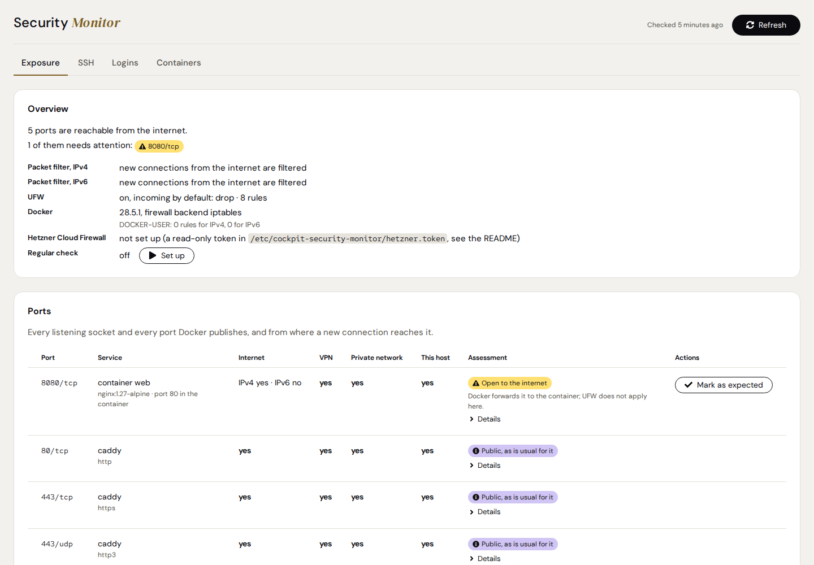
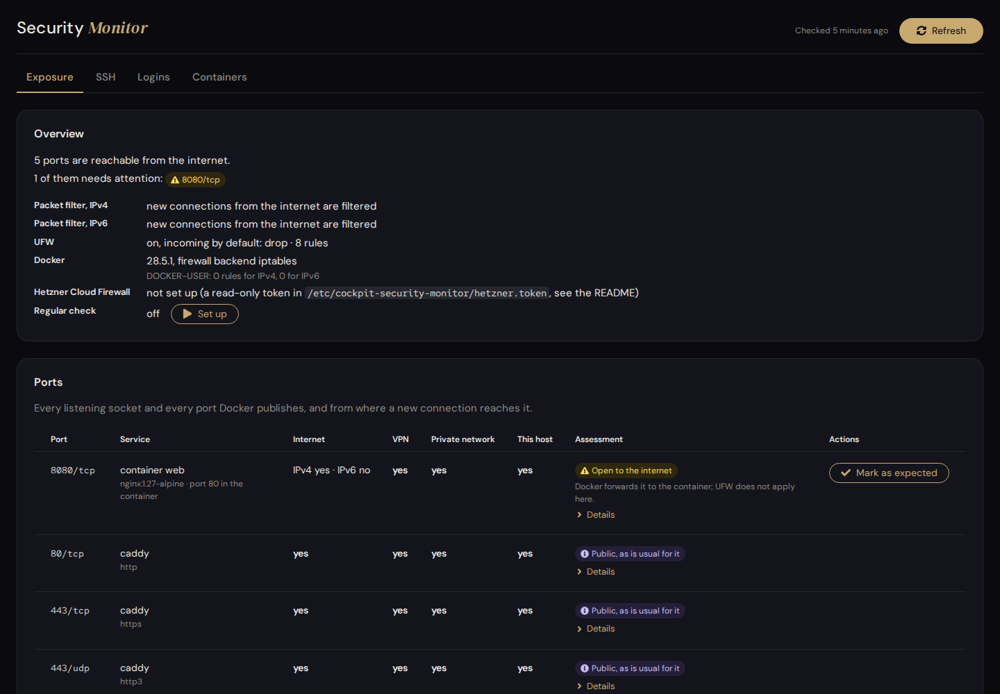
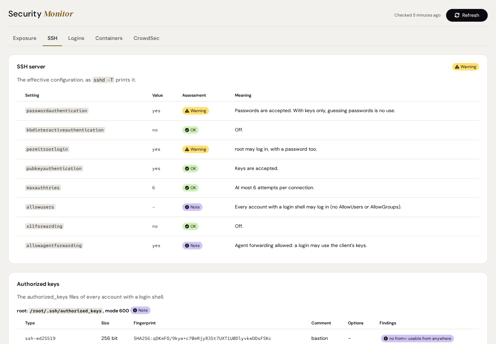
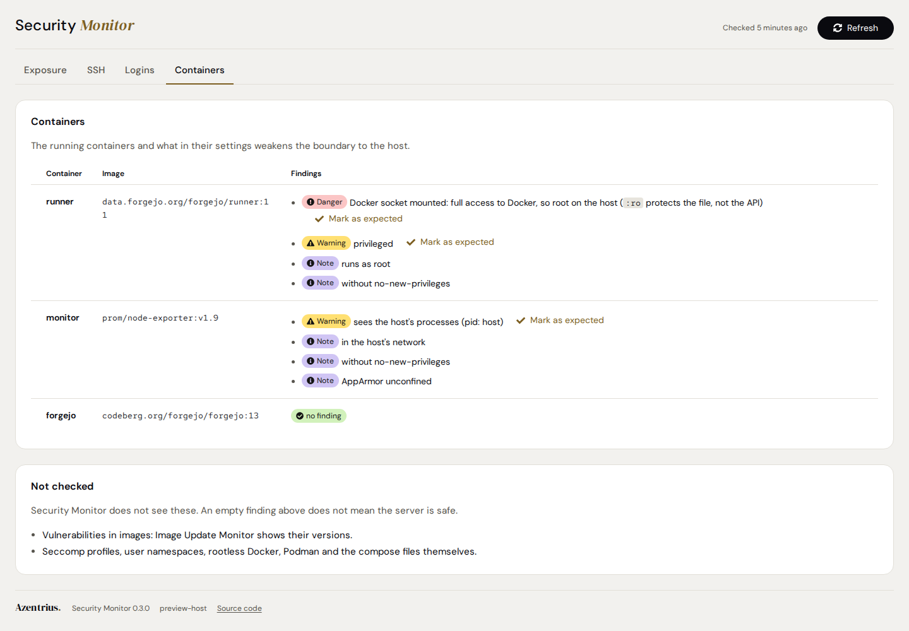
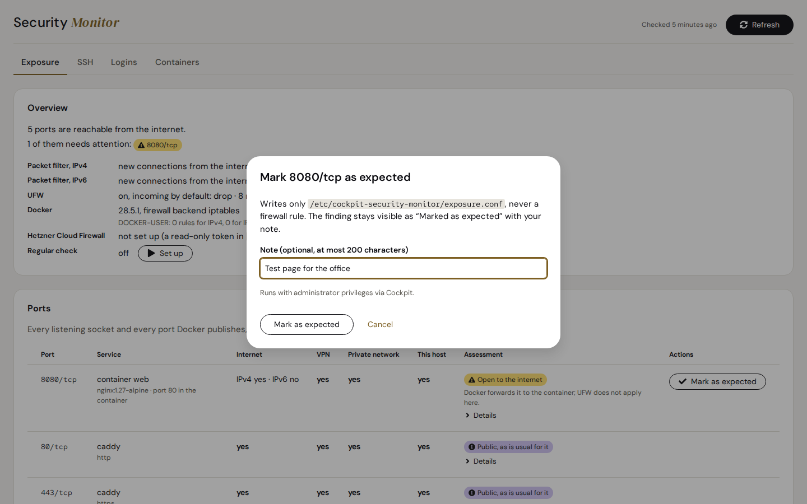
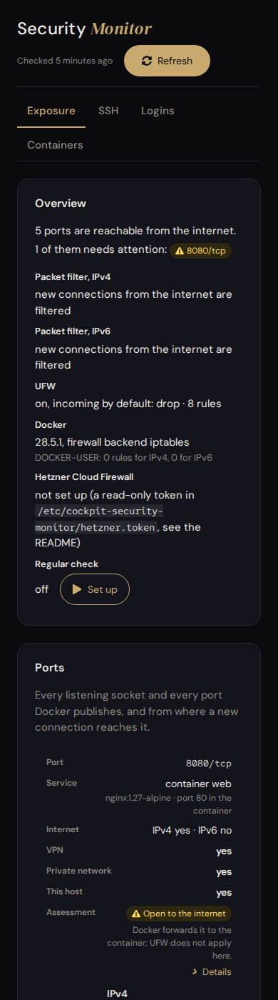
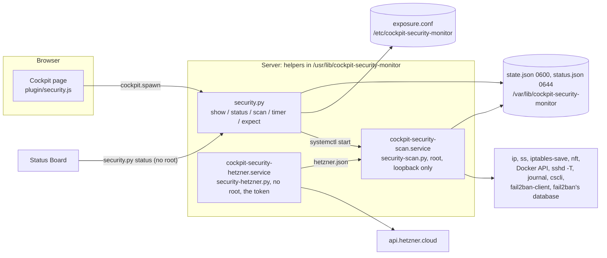

# Security Monitor

A [Cockpit](https://cockpit-project.org/) add-on that answers three questions per server: what is
reachable from where, who logs in, and what is blocked. For every port it says whether a new
connection gets in from the internet, the VPN, the private network or only the server itself, for
IPv4 and IPv6, and which rule decides. It sees what Cockpit's own firewall page does not: UFW, and
the ports Docker forwards past it.

The add-on only reads. A local service checks the server and writes the state; the page shows it.
It changes no firewall rule and nothing in CrowdSec or fail2ban. The only things the page can
change are the add-on's own regular check and the add-on's own list of findings marked as
expected.

A finding of "OK" means: in what this page checks, nothing was found. It never means "safe". What
the page does not understand is "Not assessable", never "OK", and every tab says what it does not
check.

| Light | Dark |
|---|---|
|  |  |

| SSH | Containers |
|---|---|
|  |  |

| Mark as expected | On a phone |
|---|---|
|  |  |

The screenshots show a test scenario with documentation addresses; they come from the CI artifact
`screenshots` (`tools/preview/shoot.py`).

**Contents**

- [What it checks](#what-it-checks)
- [What it does not check](#what-it-does-not-check)
- [Reading the page](#reading-the-page)
- [Architecture](#architecture)
- [Security model](#security-model)
- [Requirements](#requirements)
- [Install, update, uninstall](#install-update-uninstall)
- [The Hetzner Cloud Firewall](#the-hetzner-cloud-firewall)
- [Marking a finding as expected](#marking-a-finding-as-expected)
- [Operation and troubleshooting](#operation-and-troubleshooting)
- [Translations](#translations)
- [Development](#development)
- [Releasing](#releasing)
- [Known limits](#known-limits)
- [License](#license)

---

## What it checks

| Area | Source on the server | What the page says |
|---|---|---|
| **Exposure** of every listening socket and every port Docker publishes | `ip -j addr`, `ss -tulpn`, Docker's API (GET only), `iptables-save`, `ip6tables-save`, `nft -j list ruleset`, UFW's files | reachable from the internet, the VPN, the private network, this host; per IPv4 and IPv6; the rule or policy that decides; Docker's DNAT to the container and that UFW does not apply to it. When the addresses, the listening sockets or the packet filter cannot be read, or Docker does not answer, the page and the status say so: the ports concerned are "Not assessable", and nothing reads as "not reachable" or OK for want of data |
| **Assessment** of each port | the above | databases, Docker's API, Cockpit and SSH open to the internet: danger; web (80, 443), WireGuard and the DHCP client: a note; everything else: a warning until you mark it as expected; reachable only from some addresses: a note |
| **Hetzner Cloud Firewall** (optional) | Hetzner's API with a read-only token | a port it blocks is OK, "protected by the Hetzner Cloud Firewall"; a firewall applied to the server whose rules are not known (missing from the API's answer) counts as no protection |
| **SSH configuration** | `sshd -T`, Match blocks in `sshd_config` | passwords, keyboard-interactive with PAM, root login, keys, attempts, allow lists, X11 and agent forwarding |
| **Authorized keys** of every account with a login shell | the authorized_keys files, `/etc/shadow` | type, size, fingerprint, comment, options (`from=`, `restrict`, `command=`); DSA and RSA under 3072 bits; files others can change; an account locked with `passwd -l` whose keys still log in (with `UsePAM yes` sshd does not check the lock) is a warning |
| **Logins** of the last 14 days | the journal of `sshd`, `sshd-session`, `sudo`, `cockpit-session` | successful logins with source, account and method; failed attempts per source; a login from outside VPN and private networks is a warning; when the journal begins later than 14 days back, the page and the status say since when |
| **Container hardening** | Docker's API | the Docker socket mounted (danger, also read-only), privileged, host PIDs, extra capabilities, writable host folders (warnings), the host network, root, no-new-privileges, AppArmor (notes) |
| **CrowdSec**, when installed | `cscli` (JSON), the firewall bouncer's configuration | the service, version, bouncers, active decisions, alerts of 14 days, whether signals are shared; Ubuntu's outdated package and a bouncer that does not protect container ports are warnings |
| **fail2ban**, when installed (shown only) | `systemctl show fail2ban.service`, `fail2ban-client ping`, `status`, `status JAIL` and `-d` (the configuration it runs), its database opened read-only, the size and age of the jails' log files, the packet filter, `/etc/iptables/rules.v4` and `rules.v6` | the service, every jail with what it reads (files or the journal), where its ban takes effect (the chain or hook, from the packet filter where it is there, else from the action's options), ports and protocols, its counters since the start and its rules, the bans now and the number of bans in 14 days. Warnings: fail2ban installed but not running; a jail in the configuration that fail2ban does not run; a ban only at INPUT or the hook input in front of a port Docker publishes to the internet (Docker forwards past it; for a ban of all ports a note); a ban of TCP only while one of its ports is open for UDP from the internet (HTTP/3); a log missing or unchanged for 3 days; not one hit since fail2ban started more than a day ago while the log is not empty; addresses blocked for fail2ban that fail2ban does not manage. `f2b-` chains saved in `/etc/iptables/rules.v4` or `rules.v6` are a note. What `fail2ban-client` cannot answer (ping while the service is active, the configuration, the running jails, the status of a jail, jails past the first 30, which are not asked) is "not checked", never OK; without the database only the history is missing |

How the packet filter is followed: [docs/INTERNALS.md](docs/INTERNALS.md#the-evaluator-secfwpy).
In short: every base chain of the hooks a new connection passes, in order; addresses, ports,
protocols, interfaces, connection state, the original destination after Docker's DNAT, address
types, sets, verdict maps; sources symbolic (all of the internet, the VPN network), so a rule for
one office network makes the port "reachable only from" that network, with the rule that keeps
everyone else out. A rule it cannot read is followed both ways; if they end differently, the port
is "Not assessable" with that rule.

## What it does not check

Always listed on the page, under "Not checked":

- rules it cannot read (marks, `xt` expressions of other tools, an ipset other than as the source): a
  port they decide is "Not assessable",
- who is in an ipset: a port an ipset of sources limits is "reachable only from" that set,
- firewalls and port forwarding outside the server (routers, cloud firewalls other than Hetzner's),
- outgoing connections, ICMP, and what a service does once it is reached (its passwords, its own
  access rules),
- packets addressed to one interface that arrive on another (Linux accepts them; from outside they
  rarely reach a server),
- keys from `AuthorizedKeysCommand`, certificates, and what Match blocks change for some users,
- logins older than 14 days, logins to web applications, the source address of Cockpit sessions,
- vulnerabilities in images (the add-on
  [Image Update Monitor](https://github.com/Azentrius/cockpit-image-update-monitor) shows their
  versions), seccomp, user namespaces, rootless Docker, Podman, compose files,
- whether CrowdSec's scenarios fit the services,
- whether a fail2ban filter catches the attacks on a service (only its hits are counted;
  `fail2ban-regex` is not run), and where actions other than iptables and nftables ban.

Not part of this add-on: missing updates and restarts
([Update Gaps](https://github.com/Azentrius/cockpit-update-gaps)), cron jobs and timers
([Cron Jobs](https://github.com/Azentrius/cockpit-cronjobs)), backups, setting up CrowdSec, and
changing firewall rules (the page says which rule is missing; you set it by hand). Setting up
fail2ban and its jails, and lifting bans from the page, follow in a later version.

## Reading the page

- **Header:** when the server was checked; "Refresh" checks again (with administrative access) or
  reads the summary again (without).
- **Exposure:** an overview (how many ports the internet reaches, the packet filter per family, UFW,
  Docker and DOCKER-USER, the Hetzner Cloud Firewall, the regular check), then every port with its
  service and the four classes. "Details" under the assessment names the binding, Docker's DNAT,
  and the rule or policy that decided per class.
- **SSH, Logins, Containers, CrowdSec, fail2ban:** one tab each (CrowdSec and fail2ban only when
  installed). Links like `#/ssh` open a tab, as the Status Board does; `#/exposure/8080-tcp`, the
  link of a finding in the status, marks that port's row and brings it into view.
- **fail2ban:** the service, its version, the bans now and in 14 days, how long fail2ban keeps its
  history (`dbpurgeage`) and the findings for the whole; every jail with what it reads, where its
  ban takes effect (and whether the packet filter shows it there), its ports, counters, rules and
  findings; the addresses banned now with their class, jail, since and until when.
- **Without administrative access** the page shows only the summary the Status Board sees.
- **In Cockpit's menu:** the entry "Security Monitor" shows the same state with Cockpit's own icon
  (blue: something to know, yellow: something to look at or a state older than an hour, red: a
  danger, such as a database port open to the internet or the Docker socket in a container) and the
  summary as its tooltip; nothing found, no icon. For this Cockpit loads the page hidden after the
  login; until you open it, it only reads `/var/lib/cockpit-security-monitor/status.json` and
  checks nothing.

## Architecture



| Part | Installed to | Job |
|---|---|---|
| `plugin/` | `/usr/share/cockpit/security/` | the page (plain JavaScript, no build step), English and German |
| `lib/security-scan.py`, `seccheck.py`, `secfw.py`, `seclib.py`, `secproc.py` | `/usr/lib/cockpit-security-monitor/` | every check, the packet filter model, the parsers, commands with time limits |
| `lib/security.py`, `secstatus.py` | `/usr/lib/cockpit-security-monitor/` | the fixed verbs of the page and of the Status Board |
| `lib/security-hetzner.py` | `/usr/lib/cockpit-security-monitor/` | the read-only request to Hetzner's API |
| `systemd/` | `/usr/lib/systemd/system/` | the scan and its timer (every 15 minutes, off until set up), the Hetzner request |

The Status Board finds the status verb in the page's `manifest.json` (`azentrius.status`) and runs
`security.py status --lang en|de`, which needs no administrative access. Interfaces, formats and exit
codes: [docs/INTERNALS.md](docs/INTERNALS.md).

## Security model

- **Read only.** The scan lists; it never changes a firewall rule, never restarts anything. Docker
  is asked with GET only, on a fixed list of paths. fail2ban is asked only what it runs and whom it
  bans (`--version`, `ping`, `status`, `-d`; never a command that bans or lifts a ban); its
  database is opened read-only, and the column with log lines is never read.
- **Root without the network.** The scan runs in the host's network namespace (it lists it) with
  `IPAddressDeny=any` except the loopback, a cut-down capability set and `ProtectSystem=strict`
  (`tools/check-units.sh` checks the exposure). It writes only its own folder.
- **The token never reaches root code or the browser.** The Hetzner request runs as a user of its
  own (`DynamicUser`) that gets the token as a systemd credential (`LoadCredential=`); the page only
  sees whether a token is set up.
- **Fixed verbs.** The page calls `security.py` with fixed verbs; every argument is checked there.
- **Text, never markup.** Rule texts, container, process and jail names, key comments and log paths
  reach the page as text only.
- **Private data stays private.** `state.json` (addresses, also the banned ones, user names, key
  comments) is root's (0600); `status.json` for the Status Board holds numbers, states, ports and
  names of services, containers and fail2ban's jails only. Logins are read for 14 days, as long as
  the journal keeps them on our hosts.
- **The marks file** counts only when root owns it and nobody else can write it.
- **No network from the browser.** No CDNs or external fonts (the fonts ship with the add-on);
  Cockpit's strict CSP stays unchanged.

## Requirements

- Debian 12 or newer, or Ubuntu 22.04 or newer, with systemd and **Cockpit 264** or newer
- **Python 3.8** or newer (standard library only), `iproute2`
- Read when present (the page says what is missing): iptables (nft or legacy), nftables, UFW,
  Docker, OpenSSH, CrowdSec, fail2ban (the formats of 1.0 and 1.1)

### Supported systems

What CI really runs, and what is expected but not tested. A package that installs is not a tested
system by itself.

| | Systems | What is checked |
|---|---|---|
| **Tested** | Ubuntu 24.04 (GitHub runner) with Ubuntu's own Cockpit, UFW and fail2ban, and Docker from the runner image | the page in a real Cockpit session in Chromium (job `e2e`): installed with apt, the first check by itself through the hardened service, Docker's port reachable past UFW, fail2ban's jail on that port reported as not reaching it, a mark set and removed, "VPN only" with a DOCKER-USER rule, the regular check, the status as a user without sudo, a user without administrative access, the menu icon, links into the tabs, no JavaScript errors |
| **Tested** | Python 3.8 and 3.12 | the helper tests against the scenarios (job `python-min` and `make check`); 3.8 is the oldest supported |
| **Recorded** | four real Ubuntu servers (24.04 and 26.04) | the scan against scenarios derived from their outputs, recorded read only, with addresses, ports and names changed and containers left out (`test/fixtures/derived-*`) |
| **Package installs** | Debian 13 (`.deb`), Fedora 43 (`.rpm`) | the package installs with the distribution's own dependencies, a scan as root and the status as an unprivileged user answer, the package removes cleanly. No Cockpit, systemd or packet filter runs there. |
| **Expected, untested** | Debian 12 and 13, Ubuntu 22.04 and newer, with Cockpit 264 or newer | the page in a real Cockpit there |
| **Not supported yet** | Fedora, RHEL, openSUSE | firewalld's tables are followed like any other nft table, but not explained on their own; releases carry no `.rpm`, and the package repository serves the add-on for Debian and Ubuntu only |

## Install, update, uninstall

From the Azentrius package repository (set up once, see
[packages.azentrius.com](https://packages.azentrius.com)):

```bash
sudo apt update && sudo apt install cockpit-security-monitor
```

Or install **Security Monitor** in Cockpit under **Applications**. The system's updates keep it
current. Which systems are tested how: [Supported systems](#supported-systems).

Or from the files of a release: download the `.deb` and `SHA256SUMS`, check them, install:

```bash
sha256sum --ignore-missing -c SHA256SUMS
gh attestation verify cockpit-security-monitor_X.Y.Z-1_all.deb --repo Azentrius/cockpit-security-monitor
sudo apt install ./cockpit-security-monitor_X.Y.Z-1_all.deb
```

Or build the package yourself: `make packages` (needs dpkg-deb and rpmbuild), then
`sudo apt install ./dist/cockpit-security-monitor_X.Y.Z-1_all.deb`.

The package must be installed on each server you look at in Cockpit, also behind a Cockpit
bastion. Open the page with administrative access: it checks the server once by itself. Set up the
regular check there to keep the state, and the Status Board, current.

Uninstall: `sudo apt remove cockpit-security-monitor`. It stops the timer and removes the state;
`/etc/cockpit-security-monitor` (the marks, the token) stays.

## The Hetzner Cloud Firewall

Optional. Create a token with **Read** permission in the Hetzner Cloud Console (project › Security
› API tokens), then on the server:

```bash
sudo install -m 600 -o root -g root /dev/null /etc/cockpit-security-monitor/hetzner.token
sudo sh -c 'cat > /etc/cockpit-security-monitor/hetzner.token'   # paste the token, then Ctrl-D
sudo systemctl start cockpit-security-scan.service
```

The scan's Hetzner part (`cockpit-security-hetzner.service`) then asks the API for the servers and
firewalls of the project, finds this server by its public address and keeps the incoming rules of
its firewalls. Without a token a server without a filter of its own is "only protected by rules
outside the host, not checkable"; the same holds for a port when a firewall applied to the server
is missing from the API's answer, since its rules are not known. A failing API keeps the last good
answer; the page says how old it is. To remove it, delete the file.

## Marking a finding as expected

A port reachable from the internet that is meant to be (a relay, a game server) can be marked as
expected with a note, from the page; so can a container finding (a CI runner that needs the Docker
socket). The finding stays visible as "Marked as expected" and no longer raises the state. The mark
is a line in `/etc/cockpit-security-monitor/exposure.conf`, which you may also edit by hand:

```
port 8080/tcp Rustdesk relay, reachable on purpose
container forgejo-runner docker-socket The CI runner needs the socket
```

Setting or removing a mark on the page keeps the previous version of the file next to it as
`exposure.conf.bak` (0644, like the file itself).

## Operation and troubleshooting

```bash
sudo systemctl start cockpit-security-scan.service              # check now (what "Refresh" does)
journalctl -u cockpit-security-scan.service -n 20               # how the last check went
journalctl -u cockpit-security-hetzner.service -n 5             # the last Hetzner request
sudo /usr/lib/cockpit-security-monitor/security-scan.py | less  # the same checks, on stdout
/usr/lib/cockpit-security-monitor/security.py status --lang de  # what the Status Board shows
systemctl list-timers cockpit-security-scan.timer               # the regular check
```

`sshd -T` fails when sshd is socket-activated and `/run/sshd` is missing; the SSH tab shows the one
line for `tmpfiles.d` that fixes it.

## Translations

The page is in English and German (German addresses the user with "Sie"); it shows German when
Cockpit uses German, otherwise English. The page's texts live in `plugin/i18n.js`, the status for
the Status Board and the menu in `lib/secstatus.py`, the messages of `security.py` in its
`say(de, en)` calls. `node test/i18n.test.js` checks that every text of the page exists in both
languages with the same placeholders and plural shape, and that the English page has no German.

## Development

```bash
(cd test && npm ci)                    # jsdom for the page tests
pip install -r test/requirements.txt   # shellcheck, ruff, playwright
make check                             # every offline test
make lint                              # shellcheck, ruff, systemd units and their hardening
python3 tools/preview/build.py         # the page with the scenarios' data:
                                       # tools/preview/out/security/index.html?scenario=ufw-docker&lang=de
python3 tools/preview/shoot.py         # screenshots (light, dark, phone) to docs/img; needs Playwright
```

The helper tests run against hand-made scenarios in `test/fixtures/` (UFW with Docker past it; UFW
off behind a Hetzner Cloud Firewall with CrowdSec; nftables with a verdict map and a failing
`sshd -T`; UFW with Docker plus fail2ban with four jails), their variants, and four scenarios
derived from real servers recorded read only (`test/fixtures/capture.sh`), with addresses, ports
and names changed and containers left out, so they depict no real host. The CI job `e2e` runs on a
throw-away runner with UFW on, Docker publishing a port and fail2ban from Ubuntu with a jail in
front of that port: the page in a real Cockpit reports the port as reachable from the internet past
UFW, the jail as not reaching it, and the port as VPN only with a DOCKER-USER rule (all steps:
[Supported systems](#supported-systems)). More in [CONTRIBUTING.md](CONTRIBUTING.md).

## Releasing

1. Set the new version in `plugin/security.js` (`const VERSION`) and in every `?v=` in
   `plugin/index.html`, and add a section `## X.Y.Z – YYYY-MM-DD` to `CHANGELOG.md`
   (`tools/check-version.sh` checks that the three agree).
2. Merge to `main`.
3. On GitHub: Actions › **release** › Run workflow (branch `main`). The workflow checks the version,
   waits for the test workflow and the shared suite (workflow `e2e-suite`, with the real Host
   Settings and Status Board) of that commit to pass, runs the tests, builds the `.deb` and the
   source archive `cockpit-security-monitor-X.Y.Z.tar.gz` with `SHA256SUMS` and a signed build
   provenance, and creates the tag `vX.Y.Z` with a release whose notes come from `CHANGELOG.md`.
   Releases carry no `.rpm` yet.
4. packages.azentrius.com takes the package from the release within an hour
   ([Azentrius/packages](https://github.com/Azentrius/packages)).

## Known limits

- The packet filter is followed for new TCP and UDP connections; marks, other tools' `xt` matches
  and ipsets other than as the source are not read (the port is then "Not assessable" if they
  decide). An ipset of sources limits a port to "ipset NAME" without knowing its members; a source
  port counts as the sender's choice.
- A socket bound to a VPN or private address counts as reachable only from that class (packets for
  it from elsewhere would need a route through this server).
- Docker's nftables mode (Docker 29, experimental) is followed through its DNAT and forward chains,
  but has not been seen on a host yet.
- The Hetzner Cloud Firewall: only firewalls the API reports as applied count; one still being
  applied (`pending`) is left out until it is.
- Logins come from the journal: a host keeping it shorter shows fewer days.
- fail2ban: where a ban takes effect is judged for the iptables and nftables actions only. Only the
  first 30 jails fail2ban runs are asked for their state; more make fail2ban "not checked". The hits
  and bans of a jail are fail2ban's counters since it started; the bans of 14 days go back only as
  far as fail2ban's database keeps them (`dbpurgeage`, one day unless set otherwise), and the tab
  shows that setting.

## License

Apache-2.0, see [LICENSE](LICENSE). Third-party material (fonts, icons) is listed in
[NOTICE](NOTICE). The page contains no code from Cockpit; it uses Cockpit's API `cockpit.js` at
runtime, which Cockpit itself ships.

Please report security issues privately, see [SECURITY.md](SECURITY.md).

Made by [Azentrius](https://azentrius.com).
